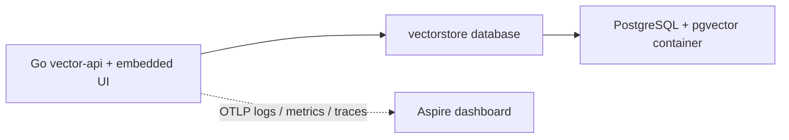

# Aspire 17 vector search playground

A Go AppHost orchestrates PostgreSQL/pgvector and a Go web application using the
library in this checkout. Search the bundled documents, compare vector/hybrid
retrieval, filter by category, and add/remove persistent notes. Open Aspire's
dashboard to follow the same searches through traces, structured logs and metrics.

## Run locally

Requirements: **Aspire CLI 17.0.0**, **Go 1.26+**, and a running Docker engine.
The Go AppHost is an Aspire preview feature. The API and AppHost are isolated Go
modules; the library's Go minimum and dependencies are unchanged. The API's local
`replace` points to this repository, so keep the sample in this checkout.

From the repository root:

```sh
cd samples/aspire-vector-search
aspire --version
aspire run
```

Use `aspire run`, not `go run apphost.go`: the CLI starts the orchestration server
and generates the typed Go SDK under ignored `.aspire/modules`. First startup
downloads the pinned integrations, Go dependencies and `pgvector/pgvector:pg18`.
No model download, cloud account or API key is needed.

Open the login link printed by Aspire. Wait for **postgres**, **vectorstore**, and
**vector-api** to become healthy, then open **vector-api → http**. API/database
ports are allocated by Aspire. The sample's HTTP dashboard/service profile uses
19170–19172; change `aspire.config.json` if those ports are already occupied.
Go AppHosts do not accept the CLI's .NET `--launch-profile` flag.

To run detached and inspect it from another terminal in this directory:

```sh
aspire start
aspire describe
aspire describe --format mermaid
aspire logs vector-api --tail 30
aspire otel traces vector-api
aspire otel logs vector-api
```

## Try it

1. Search **sqlite backup**. The SQLite document should rank first.
2. Set the category to **observability**. Filtering happens before the page limit.
3. Switch to **Hybrid** and search **postgres hybrid**. PostgreSQL combines dense
   vector and full-text candidates with reciprocal rank fusion. RRF and cosine
   similarity use different score units; the UI labels them separately.
4. Add a document such as “My backup checklist” with body “SQLite WAL backup
   restore” and category **custom**. The library generates its vector from the
   body. Search it, restart the API or AppHost, and confirm it persists.
5. Remove the note from its result card. Bundled catalog entries are protected
   from the sample's delete endpoint.
6. In Aspire, select **vector-api** and inspect **Traces**, **Structured logs**,
   and **Metrics**. A search produces an HTTP trace with a `vectorstore.search`
   child span, a correlated completion log, HTTP metrics, and
   `vectorstore.search.duration`. Metrics export every five seconds.

The default embedder is a **deterministic 12-dimensional vocabulary fixture**,
not a semantic model. It recognizes the demo topics (SQLite, PostgreSQL, Redis,
Aspire, telemetry, models, filters, backups, containers, Go, hybrid, tests). This
makes the sample fast and repeatable. For actual semantic retrieval, configure a
real `vectordata.Embedder`, matching dimensions, and a new collection; do not mix
different embedding spaces in this one.

## What Aspire owns



The AppHost declares PostgreSQL, a named database, a persistent volume, dependency
references, readiness ordering, the API HTTP endpoint and OTLP export. It injects
standard `PGHOST`, `PGPORT`, `PGUSER`, `PGPASSWORD` and `PGDATABASE` variables for
pgx. `WithReference` also records the dependency graph. Credentials are generated
by Aspire and never checked into the sample. HTTP/local database connections are
for local development.

go-vectorstore owns the typed model, automatic embeddings, HNSW/full-text/scalar
indexes, filtered retrieval and hybrid ranking. The API uses a dedicated
`aspire_demo` schema in the sample's `vectorstore` database. Eight catalog records
are upserted under stable IDs at startup; user notes have separate `note-...` IDs.
The sample adds no dependency or telemetry behavior to the library itself.

## Persistence and stopping

```sh
# Stops this AppHost and API. The persistent database/network and volume remain.
aspire stop --apphost apphost.go

# Stops this sample's persistent containers/network too; keeps the volume.
aspire stop --apphost apphost.go --force

# Explicit reset: also deletes the sample's PostgreSQL data, including your notes.
aspire stop --apphost apphost.go --force --volumes
```

The volume is named `go-vectorstore-aspire17-data`. Run one copy of this sample at
a time against that volume. `aspire run` uses Ctrl+C to stop the AppHost; the
persistent database remains available for the next run. No global Docker prune
or stop command is part of this sample.

If PostgreSQL remains Starting and Docker reports **“all predefined address pools
have been fully subnetted”**, Docker cannot allocate Aspire's development bridge.
This is an environment issue, not a database health failure. Inspect the local
Docker network configuration and choose a dedicated non-overlapping subnet or
free an unused network you own. Do not remove unrelated networks automatically.
For this workspace's local test, the sample-owned persistent network was created
with `10.254.248.0/24`; it is reused on ordinary AppHost restarts. Force-removing
that network requires addressing the pool issue again before the next run.

## Verification

```sh
aspire restore
go build -o /tmp/vector-search-apphost .
cd api
go test -race -timeout=2m ./...
go vet ./...
```

API checks need no server, model or API key. They exercise the actual typed model
with the memory provider, automatic embeddings, filtering before limits, record
lifecycle, validation and cancellation. The full Aspire run exercises real
PostgreSQL, hybrid search, persistence and OTLP telemetry. Root `go test ./...`
does not traverse these isolated modules.

## Review of the Aspire 17 announcement

The [announcement](https://devblogs.microsoft.com/aspire/whats-new-aspire-17/)
describes a platform/tooling release. For this Go repository, the strongest fit is
the new **preview Go AppHost**, typed SDK generation from the same hosting
integrations as C#, the resource-first dashboard, and runtime Mermaid export.
This sample exercises those features directly. Go AppHosts need Go 1.26+ and no
experimental Go feature flag; start them through the CLI.

The release also introduces team configuration sources, environment-specific
secrets, a tray companion, debugger attachment, and stable Kubernetes deployment.
Those are useful broader workflows but are not required for this local sample.
The .NET hosting/package migration to .NET 10 is distinct from the Go library's
toolchain requirement. Consult the
[release/migration notes](https://aspire.dev/whats-new/aspire-17/) before upgrading
other Aspire applications; the global CLI upgrade does not migrate their packages.

References: [Go AppHosts](https://aspire.dev/app-host/go-apphost/),
[Go API reference](https://aspire.dev/reference/api/go/), and
[dashboard](https://aspire.dev/dashboard/overview/).
